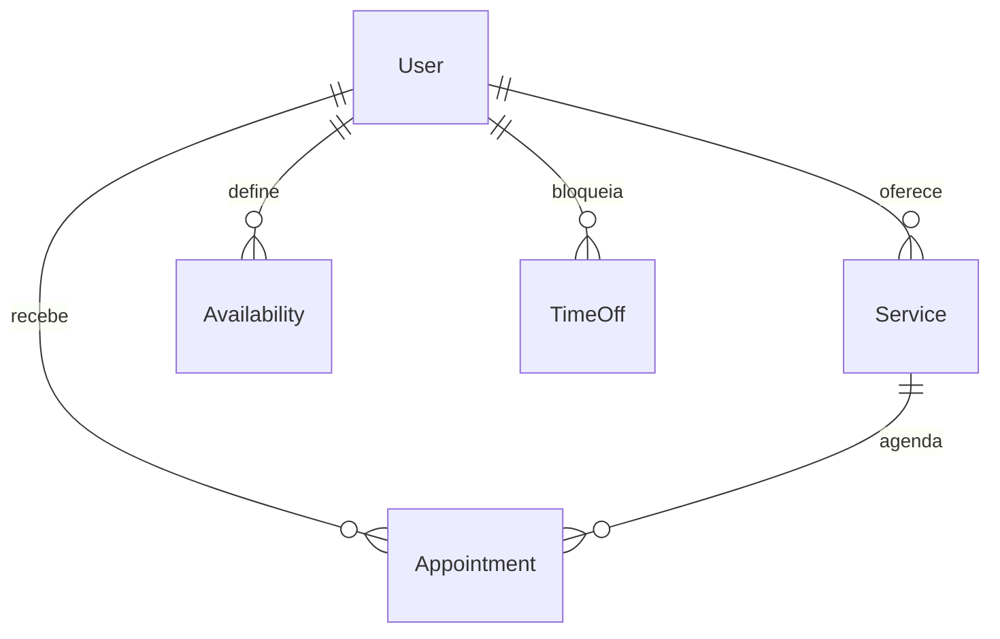

# Agendaki

Aplicação web de agendamento online para prestadores de serviço.

## Tecnologias

- Next.js (App Router)
- TypeScript
- Tailwind CSS
- Prisma
- SQLite em desenvolvimento
- PostgreSQL preparado para produção

## Instalação

Pré-requisitos: Node.js 20 ou superior e npm.

```bash
npm install
copy .env.example .env
npm run db:migrate -- --name init
npm run db:seed
npx prisma generate
```

Defina `AUTH_SECRET` no `.env` com um valor aleatório (por exemplo,
`npx auth secret`). O `.env.example` também inclui `AUTH_URL` para o ambiente
local.

No PowerShell, use `Copy-Item .env.example .env` caso `copy` não esteja disponível.

## Desenvolvimento

```bash
npm run dev
```

Acesse `http://localhost:3000`.

## Comandos

```bash
npm run dev
npm run build
npm run lint
npm run format
npm run test
npx prisma studio
```

## Modelo de dados



`User` tem papel de prestador ou cliente. Serviços, disponibilidades e folgas
pertencem ao prestador; cada agendamento referencia um serviço e um prestador,
além de guardar os dados de contato do cliente. Os agendamentos têm status e
token de cancelamento único. Preços de serviços são armazenados em centavos
(`priceCents`).
`Availability.dayOfWeek` usa `0` para domingo e `6` para sábado.

Para recriar o banco local, execute `npm run db:migrate -- --name init`. O seed
é idempotente e cria o prestador `prestador@agendaki.dev`, três serviços,
disponibilidade de segunda a sexta-feira, das 9h às 18h, e dois agendamentos
futuros de exemplo. A senha demonstrativa usada no seed é `agendaki-demo`.

## Autenticação

Prestadores podem criar conta em `/cadastro` e entrar em `/login`. Senhas são
armazenadas com bcrypt; as rotas em `/painel` exigem uma sessão autenticada.
No Next.js 16, `src/proxy.ts` (renomeação do middleware) redireciona usuários
não autenticados ao login e impede que usuários autenticados acessem `/login`.

## Gestão de serviços

Em `/painel/servicos`, cada prestador pode listar, criar, editar, ativar,
desativar e excluir seus próprios serviços. Serviços com agendamentos futuros
não podem ser excluídos; desativá-los preserva os agendamentos. O preço fica
armazenado em centavos (`priceCents`) e é exibido em reais na interface.

## Emails transacionais

Em desenvolvimento, os emails são exibidos no console. Em produção, o envio
usa a API do Resend. Configure `APP_URL`, `RESEND_API_KEY` e `EMAIL_FROM` no
ambiente de produção; o endereço remetente precisa estar verificado no Resend.
O envio da confirmação e do aviso ao prestador não impede a criação da reserva
se o provedor de email falhar.

Confirmações incluem um link seguro para o cliente cancelar o agendamento. O
prestador também recebe emails quando um novo agendamento é feito ou cancelado.
O cliente recebe um lembrete próximo de 24 horas antes do horário.

Configure um cron para chamar `GET /api/cron/appointment-reminders` a cada 15
minutos, enviando `Authorization: Bearer <CRON_SECRET>`. O endpoint processa
lembretes ainda não enviados e registra o envio para evitar duplicidades.
